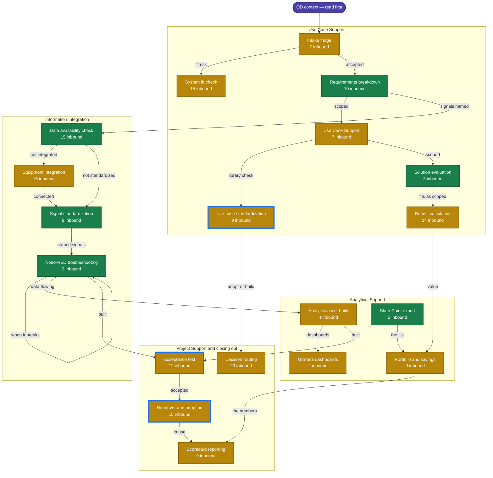

# Skill state map

<!-- Generated by scripts/build_skill_map.py — do not edit by hand. -->

**47 skills.** 11 carry references and a runnable script, 35 carry references, 1 are still a `SKILL.md` on its own.

Boxes follow the order work actually moves through the four lanes. Colour is build state, not importance — a stub can be a perfectly good procedure that simply has no reference material or tooling behind it yet.

| | Meaning |
|---|---|
| 🟩 **Deep** | References *and* a runnable script — the check can be executed, not just read |
| 🟨 **Documented** | References carry the substance; no tooling yet |
| ⬜ **Stub** | `SKILL.md` alone. A complete procedure, with nothing behind it |
| 🔵 **Blue outline** | Recommended next |

## Where it stands

| Skill | Lane | State | Refs | Scripts | Inbound |
|---|---|---|--:|--:|--:|
| [`od-requirements-breakdown`](../skills/od-requirements-breakdown/SKILL.md) | Use Case Support | 🟩 deep | 7 | 1 | 10 |
| [`od-use-case-solution-evaluation`](../skills-extension/od-use-case-solution-evaluation/SKILL.md) | Use Case Support | 🟩 deep | 6 | 1 | 3 |
| [`od-data-availability-check`](../skills/od-data-availability-check/SKILL.md) | Information Integration | 🟩 deep | 9 | 1 | 15 |
| [`od-signal-standardization`](../skills/od-signal-standardization/SKILL.md) | Information Integration | 🟩 deep | 13 | 1 | 9 |
| [`od-node-red-flow-builder`](../skills/od-node-red-flow-builder/SKILL.md) | Information Integration | 🟩 deep | 18 | 2 | 2 |
| [`od-sharepoint-list-export`](../skills-extension/od-sharepoint-list-export/SKILL.md) | Analytical Support | 🟩 deep | 3 | 1 | 2 |
| [`bc-assessment`](../skills/bc-assessment/SKILL.md) | — | 🟩 deep | 8 | 1 | 0 |
| [`funnel-features`](../skills-extension/funnel-features/SKILL.md) | — | 🟩 deep | 2 | 1 | 1 |
| [`it-demand-package`](../skills/it-demand-package/SKILL.md) | — | 🟩 deep | 3 | 2 | 9 |
| [`od-capital-request`](../skills/od-capital-request/SKILL.md) | — | 🟩 deep | 11 | 1 | 6 |
| [`od-context-freshness`](../skills-extension/od-context-freshness/SKILL.md) | — | 🟩 deep | 5 | 1 | 2 |
| [`od-use-case-intake-triage`](../skills/od-use-case-intake-triage/SKILL.md) | Use Case Support | 🟨 documented | 3 | 0 | 7 |
| [`od-system-fit-check`](../skills/od-system-fit-check/SKILL.md) | Use Case Support | 🟨 documented | 15 | 0 | 15 |
| [`od-use-case-definition`](../skills/od-use-case-definition/SKILL.md) | Use Case Support | 🟨 documented | 10 | 0 | 7 |
| [`od-use-case-standardization`](../skills-extension/od-use-case-standardization/SKILL.md) | Use Case Support | 🟨 documented | 4 | 0 | 9 |
| [`od-benefit-calculation`](../skills/od-benefit-calculation/SKILL.md) | Use Case Support | 🟨 documented | 7 | 0 | 14 |
| [`od-equipment-integration`](../skills/od-equipment-integration/SKILL.md) | Information Integration | 🟨 documented | 15 | 0 | 15 |
| [`od-analytics-asset-build`](../skills/od-analytics-asset-build/SKILL.md) | Analytical Support | 🟨 documented | 11 | 0 | 4 |
| [`build-grafana-ops-dashboard`](../skills-extension/build-grafana-ops-dashboard/SKILL.md) | Analytical Support | 🟨 documented | 10 | 0 | 2 |
| [`od-portfolio-and-savings-analysis`](../skills-extension/od-portfolio-and-savings-analysis/SKILL.md) | Analytical Support | 🟨 documented | 6 | 0 | 9 |
| [`od-acceptance-test`](../skills/od-acceptance-test/SKILL.md) | Project Support and closing out | 🟨 documented | 7 | 0 | 12 |
| [`od-handover-and-adoption`](../skills/od-handover-and-adoption/SKILL.md) | Project Support and closing out | 🟨 documented | 5 | 0 | 15 |
| [`od-scorecard-reporting`](../skills-extension/od-scorecard-reporting/SKILL.md) | Project Support and closing out | 🟨 documented | 6 | 0 | 9 |
| [`od-decision-routing`](../skills/od-decision-routing/SKILL.md) | Project Support and closing out | 🟨 documented | 4 | 0 | 23 |
| [`catalog-guardrails`](../skills/catalog-guardrails/SKILL.md) | — | 🟨 documented | 2 | 0 | 2 |
| [`catalog-systems`](../skills/catalog-systems/SKILL.md) | — | 🟨 documented | 4 | 0 | 1 |
| [`catalog-usecase`](../skills/catalog-usecase/SKILL.md) | — | 🟨 documented | 8 | 0 | 7 |
| [`deploy-appstore`](../skills/deploy-appstore/SKILL.md) | — | 🟨 documented | 6 | 0 | 5 |
| [`od-ai-generation-playbook`](../skills-extension/od-ai-generation-playbook/SKILL.md) | — | 🟨 documented | 5 | 0 | 0 |
| [`od-context`](../skills-extension/od-context/SKILL.md) | — | 🟨 documented | 5 | 0 | 0 |
| [`od-cross-plant-compatibility`](../skills-extension/od-cross-plant-compatibility/SKILL.md) | — | 🟨 documented | 4 | 0 | 3 |
| [`od-cybersec-gate`](../skills-extension/od-cybersec-gate/SKILL.md) | — | 🟨 documented | 5 | 0 | 9 |
| [`od-event-object-modelling`](../skills-extension/od-event-object-modelling/SKILL.md) | — | 🟨 documented | 4 | 0 | 0 |
| [`od-first-aid-kit`](../skills-extension/od-first-aid-kit/SKILL.md) | — | 🟨 documented | 3 | 0 | 2 |
| [`od-governance-cadence`](../skills-extension/od-governance-cadence/SKILL.md) | — | 🟨 documented | 6 | 0 | 0 |
| [`od-investment-input`](../skills-extension/od-investment-input/SKILL.md) | — | 🟨 documented | 4 | 0 | 6 |
| [`od-migration-cutover`](../skills-extension/od-migration-cutover/SKILL.md) | — | 🟨 documented | 4 | 0 | 0 |
| [`od-plant-diagnosis`](../skills-extension/od-plant-diagnosis/SKILL.md) | — | 🟨 documented | 5 | 0 | 0 |
| [`od-plant-onboarding`](../skills-extension/od-plant-onboarding/SKILL.md) | — | 🟨 documented | 3 | 0 | 3 |
| [`od-project-order`](../skills-extension/od-project-order/SKILL.md) | — | 🟨 documented | 4 | 0 | 0 |
| [`od-prototype-poc`](../skills/od-prototype-poc/SKILL.md) | — | 🟨 documented | 7 | 0 | 4 |
| [`od-retro`](../skills-extension/od-retro/SKILL.md) | — | 🟨 documented | 4 | 0 | 4 |
| [`od-risk-watch`](../skills-extension/od-risk-watch/SKILL.md) | — | 🟨 documented | 3 | 0 | 6 |
| [`od-rollout-training`](../skills-extension/od-rollout-training/SKILL.md) | — | 🟨 documented | 5 | 0 | 2 |
| [`od-template-resolution`](../skills-extension/od-template-resolution/SKILL.md) | — | 🟨 documented | 3 | 0 | 2 |
| [`od-workshop-facilitation`](../skills-extension/od-workshop-facilitation/SKILL.md) | — | 🟨 documented | 3 | 0 | 1 |
| [`ops-dashboard-datatron`](../skills-extension/ops-dashboard-datatron/SKILL.md) | — | ⬜ stub | 0 | 0 | 0 |

## What is next, and why

- **[`od-acceptance-test`](../skills/od-acceptance-test/SKILL.md)** — **8 inbound — the most-composed skill in the registry, and the thinnest at 468 words.** It is the gate between *delivered* and *accepted*, which every lane's definition of done turns on
- **[`od-use-case-standardization`](../skills-extension/od-use-case-standardization/SKILL.md)** — 5 inbound · adoption is the shortfall the department names itself, and 100 library use cases already exist to check against
- **[`od-handover-and-adoption`](../skills/od-handover-and-adoption/SKILL.md)** — 5 inbound · the IMPLEMENTED-vs-PRODUCTIVE gap lives here, and 129 use cases sit on the wrong side of it

*Inbound* counts how many other skills name this one in `composes`. It is the cheapest proxy for what the rest of the registry is leaning on, and it is what picked the last two skills built.

## Not on the map

The four lane skills and `deploy-appstore`, `od-capital-request`, `od-context-freshness`, `od-cross-plant-compatibility`, `od-cybersec-gate`, `od-first-aid-kit`, `od-investment-input`, `od-plant-onboarding`, `od-prototype-poc`, `od-retro`, `od-risk-watch`, `od-rollout-training`, `od-template-resolution`, `od-workshop-facilitation`, `od-ai-generation-playbook`, `od-event-object-modelling`, `od-governance-cadence`, `od-migration-cutover`, `od-plant-diagnosis`, `od-project-order`, `catalog-usecase`, `it-demand-package`, `funnel-features`, `bc-assessment`, `catalog-guardrails`, `catalog-systems`, `ops-dashboard-datatron` are entry points rather than steps, so they carry no position in the delivery order.
