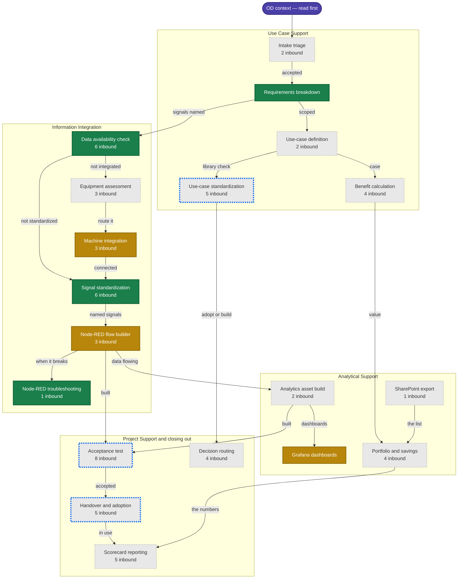

# Skill state map

<!-- Generated by scripts/build_skill_map.py — do not edit by hand. -->

**24 skills.** 4 carry references and a runnable script, 3 carry references, 17 are still a `SKILL.md` on its own.

Boxes follow the order work actually moves through the four lanes. Colour is build state, not importance — a stub can be a perfectly good procedure that simply has no reference material or tooling behind it yet.

| | Meaning |
|---|---|
| 🟩 **Deep** | References *and* a runnable script — the check can be executed, not just read |
| 🟨 **Documented** | References carry the substance; no tooling yet |
| ⬜ **Stub** | `SKILL.md` alone. A complete procedure, with nothing behind it |
| 🔵 **Blue outline** | Recommended next |

## Where it stands

| Skill | Lane | State | Refs | Scripts | Inbound |
|---|---|---|--:|--:|--:|
| [`od-requirements-breakdown`](../skills/od-requirements-breakdown/SKILL.md) | Use Case Support | 🟩 deep | 5 | 2 | 0 |
| [`od-data-availability-check`](../skills/od-data-availability-check/SKILL.md) | Information Integration | 🟩 deep | 5 | 1 | 6 |
| [`od-signal-standardization`](../skills/od-signal-standardization/SKILL.md) | Information Integration | 🟩 deep | 7 | 1 | 6 |
| [`od-node-red-flow-troubleshooting`](../skills/od-node-red-flow-troubleshooting/SKILL.md) | Information Integration | 🟩 deep | 2 | 1 | 1 |
| [`od-machine-integration-guidance`](../skills/od-machine-integration-guidance/SKILL.md) | Information Integration | 🟨 documented | 8 | 0 | 3 |
| [`od-node-red-flow-builder`](../skills/od-node-red-flow-builder/SKILL.md) | Information Integration | 🟨 documented | 10 | 0 | 3 |
| [`build-grafana-ops-dashboard`](../skills/build-grafana-ops-dashboard/SKILL.md) | Analytical Support | 🟨 documented | 10 | 0 | 0 |
| [`od-use-case-intake-triage`](../skills/od-use-case-intake-triage/SKILL.md) | Use Case Support | ⬜ stub | 0 | 0 | 2 |
| [`od-use-case-definition`](../skills/od-use-case-definition/SKILL.md) | Use Case Support | ⬜ stub | 0 | 0 | 2 |
| [`od-use-case-standardization`](../skills/od-use-case-standardization/SKILL.md) | Use Case Support | ⬜ stub | 0 | 0 | 5 |
| [`od-benefit-calculation`](../skills/od-benefit-calculation/SKILL.md) | Use Case Support | ⬜ stub | 0 | 0 | 4 |
| [`od-equipment-integration-assessment`](../skills/od-equipment-integration-assessment/SKILL.md) | Information Integration | ⬜ stub | 0 | 0 | 3 |
| [`od-analytics-asset-build`](../skills/od-analytics-asset-build/SKILL.md) | Analytical Support | ⬜ stub | 0 | 0 | 2 |
| [`od-portfolio-and-savings-analysis`](../skills/od-portfolio-and-savings-analysis/SKILL.md) | Analytical Support | ⬜ stub | 0 | 0 | 4 |
| [`od-sharepoint-list-export`](../skills/od-sharepoint-list-export/SKILL.md) | Analytical Support | ⬜ stub | 0 | 0 | 1 |
| [`od-acceptance-test`](../skills/od-acceptance-test/SKILL.md) | Project Support and closing out | ⬜ stub | 0 | 0 | 8 |
| [`od-handover-and-adoption`](../skills/od-handover-and-adoption/SKILL.md) | Project Support and closing out | ⬜ stub | 0 | 0 | 5 |
| [`od-scorecard-reporting`](../skills/od-scorecard-reporting/SKILL.md) | Project Support and closing out | ⬜ stub | 0 | 0 | 5 |
| [`od-decision-routing`](../skills/od-decision-routing/SKILL.md) | Project Support and closing out | ⬜ stub | 0 | 0 | 4 |
| [`od-analytical-support-service`](../skills/od-analytical-support-service/SKILL.md) | — | ⬜ stub | 0 | 0 | 0 |
| [`od-context`](../skills/od-context/SKILL.md) | — | ⬜ stub | 0 | 0 | 0 |
| [`od-information-integration-service`](../skills/od-information-integration-service/SKILL.md) | — | ⬜ stub | 0 | 0 | 0 |
| [`od-project-support-consultancy`](../skills/od-project-support-consultancy/SKILL.md) | — | ⬜ stub | 0 | 0 | 0 |
| [`od-use-case-support-service`](../skills/od-use-case-support-service/SKILL.md) | — | ⬜ stub | 0 | 0 | 0 |

## What is next, and why

- **[`od-acceptance-test`](../skills/od-acceptance-test/SKILL.md)** — **8 inbound — the most-composed skill in the registry, and the thinnest at 468 words.** It is the gate between *delivered* and *accepted*, which every lane's definition of done turns on
- **[`od-use-case-standardization`](../skills/od-use-case-standardization/SKILL.md)** — 5 inbound · adoption is the shortfall the department names itself, and 100 library use cases already exist to check against
- **[`od-handover-and-adoption`](../skills/od-handover-and-adoption/SKILL.md)** — 5 inbound · the IMPLEMENTED-vs-PRODUCTIVE gap lives here, and 129 use cases sit on the wrong side of it

*Inbound* counts how many other skills name this one in `composes`. It is the cheapest proxy for what the rest of the registry is leaning on, and it is what picked the last two skills built.

## Not on the map

The four lane skills (`od-use-case-support-service`, `od-information-integration-service`, `od-project-support-consultancy`, `od-analytical-support-service`) are entry points rather than steps: each one names the skills its lane calls, so they sit above this diagram rather than in it. All four are still stubs.
