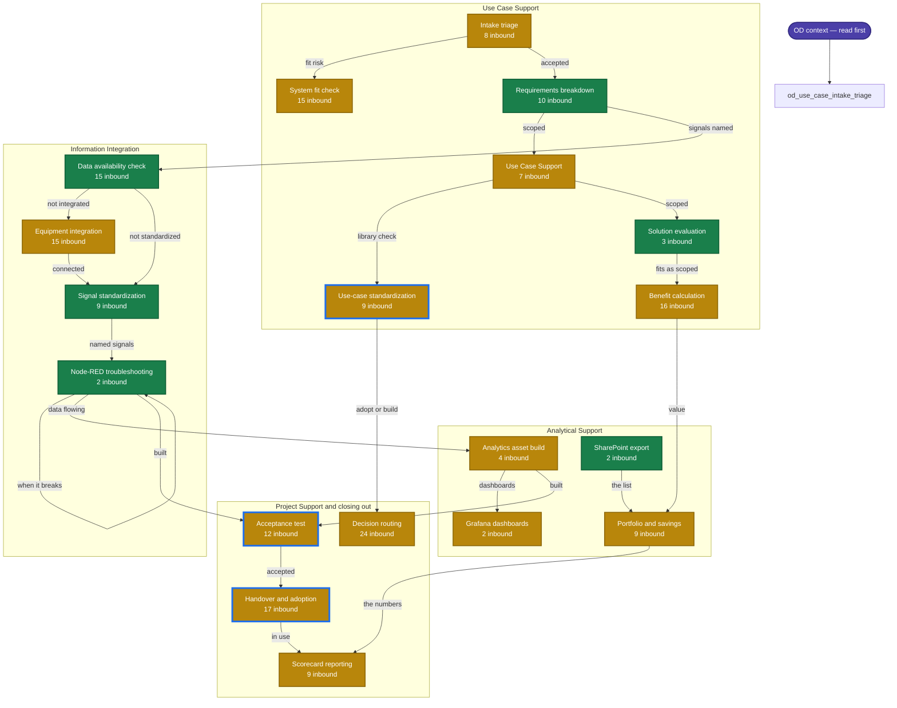

# Skill state map

<!-- Generated by scripts/build_skill_map.py — do not edit by hand. -->

**51 skills.** 13 carry references and a runnable script, 38 carry references, 0 are still a `SKILL.md` on its own.

Boxes follow the order work actually moves through the four lanes. Colour is build state, not importance — a stub can be a perfectly good procedure that simply has no reference material or tooling behind it yet.

| | Meaning |
|---|---|
| 🟩 **Deep** | References *and* a runnable script — the check can be executed, not just read |
| 🟨 **Documented** | References carry the substance; no tooling yet |
| ⬜ **Stub** | `SKILL.md` alone. A complete procedure, with nothing behind it |
| 🔵 **Blue outline** | Recommended next |

## Where it stands

| Skill | Lane | State | Refs | Scripts | Inbound |
|---|---|---|--:|--:|--:|
| [`funnel-requirements`](../skills/funnel-requirements/SKILL.md) | Use Case Support | 🟩 deep | 8 | 1 | 10 |
| [`funnel-evaluation`](../skills-extension/funnel-evaluation/SKILL.md) | Use Case Support | 🟩 deep | 7 | 1 | 3 |
| [`mi-data-availability`](../skills/mi-data-availability/SKILL.md) | Information Integration | 🟩 deep | 10 | 1 | 15 |
| [`mi-signals`](../skills/mi-signals/SKILL.md) | Information Integration | 🟩 deep | 14 | 1 | 9 |
| [`mi-flow`](../skills/mi-flow/SKILL.md) | Information Integration | 🟩 deep | 19 | 2 | 2 |
| [`know-sharepoint-export`](../skills-extension/know-sharepoint-export/SKILL.md) | Analytical Support | 🟩 deep | 4 | 1 | 2 |
| [`bc-assess`](../skills/bc-assess/SKILL.md) | — | 🟩 deep | 9 | 1 | 0 |
| [`bc-capital-request`](../skills/bc-capital-request/SKILL.md) | — | 🟩 deep | 12 | 1 | 6 |
| [`comms-brief`](../skills/comms-brief/SKILL.md) | — | 🟩 deep | 5 | 2 | 2 |
| [`deploy-it-demand`](../skills/deploy-it-demand/SKILL.md) | — | 🟩 deep | 6 | 3 | 9 |
| [`dept-context-freshness`](../skills-extension/dept-context-freshness/SKILL.md) | — | 🟩 deep | 6 | 1 | 3 |
| [`funnel-features`](../skills-extension/funnel-features/SKILL.md) | — | 🟩 deep | 3 | 1 | 1 |
| [`know-skill-authoring`](../skills-extension/know-skill-authoring/SKILL.md) | — | 🟩 deep | 5 | 2 | 0 |
| [`dept-intake`](../skills/dept-intake/SKILL.md) | Use Case Support | 🟨 documented | 4 | 0 | 8 |
| [`invest-screen`](../skills/invest-screen/SKILL.md) | Use Case Support | 🟨 documented | 16 | 0 | 15 |
| [`funnel-use-case`](../skills/funnel-use-case/SKILL.md) | Use Case Support | 🟨 documented | 11 | 0 | 7 |
| [`catalog-standardization`](../skills-extension/catalog-standardization/SKILL.md) | Use Case Support | 🟨 documented | 5 | 0 | 9 |
| [`bc-build`](../skills/bc-build/SKILL.md) | Use Case Support | 🟨 documented | 8 | 0 | 16 |
| [`mi-equipment`](../skills/mi-equipment/SKILL.md) | Information Integration | 🟨 documented | 16 | 0 | 15 |
| [`ops-analytics-asset`](../skills/ops-analytics-asset/SKILL.md) | Analytical Support | 🟨 documented | 12 | 0 | 4 |
| [`ops-dashboard-engine`](../skills/ops-dashboard-engine/SKILL.md) | Analytical Support | 🟨 documented | 11 | 0 | 2 |
| [`bc-portfolio`](../skills-extension/bc-portfolio/SKILL.md) | Analytical Support | 🟨 documented | 7 | 0 | 9 |
| [`deploy-acceptance`](../skills/deploy-acceptance/SKILL.md) | Project Support and closing out | 🟨 documented | 8 | 0 | 12 |
| [`deploy-handover`](../skills/deploy-handover/SKILL.md) | Project Support and closing out | 🟨 documented | 6 | 0 | 17 |
| [`metrics-scorecard`](../skills-extension/metrics-scorecard/SKILL.md) | Project Support and closing out | 🟨 documented | 7 | 0 | 9 |
| [`dept-decision-rights`](../skills/dept-decision-rights/SKILL.md) | Project Support and closing out | 🟨 documented | 5 | 0 | 24 |
| [`bc-cost`](../skills-extension/bc-cost/SKILL.md) | — | 🟨 documented | 5 | 0 | 6 |
| [`catalog-compatibility`](../skills-extension/catalog-compatibility/SKILL.md) | — | 🟨 documented | 5 | 0 | 3 |
| [`catalog-guardrails`](../skills/catalog-guardrails/SKILL.md) | — | 🟨 documented | 3 | 0 | 2 |
| [`catalog-systems`](../skills/catalog-systems/SKILL.md) | — | 🟨 documented | 5 | 0 | 1 |
| [`catalog-template`](../skills-extension/catalog-template/SKILL.md) | — | 🟨 documented | 4 | 0 | 2 |
| [`catalog-usecase`](../skills/catalog-usecase/SKILL.md) | — | 🟨 documented | 9 | 0 | 10 |
| [`comms-followup`](../skills/comms-followup/SKILL.md) | — | 🟨 documented | 3 | 0 | 1 |
| [`comms-showcase`](../skills/comms-showcase/SKILL.md) | — | 🟨 documented | 3 | 0 | 1 |
| [`deploy-appstore`](../skills/deploy-appstore/SKILL.md) | — | 🟨 documented | 7 | 0 | 5 |
| [`deploy-cybersec`](../skills-extension/deploy-cybersec/SKILL.md) | — | 🟨 documented | 6 | 0 | 9 |
| [`deploy-migration`](../skills-extension/deploy-migration/SKILL.md) | — | 🟨 documented | 5 | 0 | 0 |
| [`deploy-project-order`](../skills-extension/deploy-project-order/SKILL.md) | — | 🟨 documented | 5 | 0 | 0 |
| [`dept-context`](../skills/dept-context/SKILL.md) | — | 🟨 documented | 6 | 0 | 0 |
| [`dept-governance`](../skills-extension/dept-governance/SKILL.md) | — | 🟨 documented | 7 | 0 | 0 |
| [`dept-plant-diagnosis`](../skills-extension/dept-plant-diagnosis/SKILL.md) | — | 🟨 documented | 6 | 0 | 0 |
| [`dept-plant-onboarding`](../skills-extension/dept-plant-onboarding/SKILL.md) | — | 🟨 documented | 4 | 0 | 3 |
| [`dept-retro`](../skills-extension/dept-retro/SKILL.md) | — | 🟨 documented | 5 | 0 | 4 |
| [`dept-risk`](../skills-extension/dept-risk/SKILL.md) | — | 🟨 documented | 4 | 0 | 6 |
| [`funnel-first-aid`](../skills-extension/funnel-first-aid/SKILL.md) | — | 🟨 documented | 4 | 0 | 2 |
| [`funnel-prototype`](../skills/funnel-prototype/SKILL.md) | — | 🟨 documented | 8 | 0 | 4 |
| [`funnel-workshop`](../skills-extension/funnel-workshop/SKILL.md) | — | 🟨 documented | 4 | 0 | 1 |
| [`know-ai-generation`](../skills-extension/know-ai-generation/SKILL.md) | — | 🟨 documented | 6 | 0 | 1 |
| [`know-training`](../skills-extension/know-training/SKILL.md) | — | 🟨 documented | 6 | 0 | 2 |
| [`ops-dashboard-datatron`](../skills-extension/ops-dashboard-datatron/SKILL.md) | — | 🟨 documented | 2 | 0 | 0 |
| [`ops-event-model`](../skills-extension/ops-event-model/SKILL.md) | — | 🟨 documented | 5 | 0 | 0 |

## What is next, and why

- **[`deploy-acceptance`](../skills/deploy-acceptance/SKILL.md)** — **8 inbound — the most-composed skill in the registry, and the thinnest at 468 words.** It is the gate between *delivered* and *accepted*, which every lane's definition of done turns on
- **[`catalog-standardization`](../skills-extension/catalog-standardization/SKILL.md)** — 5 inbound · adoption is the shortfall the department names itself, and 100 library use cases already exist to check against
- **[`deploy-handover`](../skills/deploy-handover/SKILL.md)** — 5 inbound · the IMPLEMENTED-vs-PRODUCTIVE gap lives here, and 129 use cases sit on the wrong side of it

*Inbound* counts how many other skills name this one in `composes`. It is the cheapest proxy for what the rest of the registry is leaning on, and it is what picked the last two skills built.

## Not on the map

The four lane skills and `deploy-appstore`, `bc-capital-request`, `dept-context-freshness`, `catalog-compatibility`, `deploy-cybersec`, `funnel-first-aid`, `bc-cost`, `dept-plant-onboarding`, `funnel-prototype`, `dept-retro`, `dept-risk`, `know-training`, `catalog-template`, `funnel-workshop`, `know-ai-generation`, `know-skill-authoring`, `ops-event-model`, `dept-governance`, `deploy-migration`, `dept-plant-diagnosis`, `deploy-project-order`, `catalog-usecase`, `deploy-it-demand`, `funnel-features`, `bc-assess`, `catalog-guardrails`, `comms-showcase`, `comms-brief`, `comms-followup`, `catalog-systems`, `ops-dashboard-datatron` are entry points rather than steps, so they carry no position in the delivery order.
